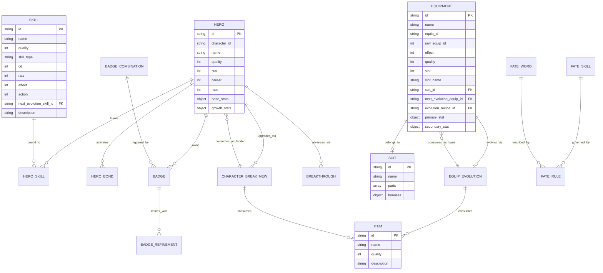

# BÁO CÁO KỸ THUẬT DỮ LIỆU - SIÊU ANH HÙNG HỘI TỤ WIKI (SAHHT WIKI)
**Dự án:** Kho dữ liệu quan hệ chuẩn hóa cho Wiki Siêu Anh Hùng Hội Tụ  
**Phiên bản Pipeline:** 1.2.0  
**Thời gian chạy thực tế:** 2026-10-18T18:03:25+02:00  
**Kỹ sư dữ liệu:** Antigravity AI Data Engineering Team  

---

## 1. TỔNG QUAN VÀ MỤC TIÊU DỰ ÁN

Giai đoạn 1 của dự án **Siêu Anh Hùng Hội Tụ WIKI** tập trung vào việc nghiên cứu, trích xuất tĩnh, chuẩn hóa và xây dựng kho dữ liệu quan hệ có cấu trúc từ gói xuất bản game Android của trò chơi.

Mục tiêu chính là chuyển đổi hàng trăm tệp cấu hình thô rời rạc thành một hệ cơ sở dữ liệu JSON sẵn sàng để sử dụng cho website Wiki tra cứu, bao gồm:
1. **Tướng (Heroes / Champions):** Chỉ số khởi đầu, tăng trưởng, kỹ năng, duyên phận, đột phá, thức tỉnh. Bảo tồn 100% trường nguồn gốc.
2. **Kỹ năng (Skills):** Thời gian hồi chiêu, xác suất kích hoạt, cơ chế sát thương, bảo toàn nguyên vẹn giá trị `action: 0` và liên kết tiến hóa.
3. **Trang bị (Equipment):** Phân loại đúng 4 vị trí: **Slot 1 (Vũ khí), Slot 2 (Trang sức), Slot 3 (Giáp/Áo), Slot 4 (Giày)**; khôi phục `equip_id` và `effect`, liên kết bộ và tiến hóa.
4. **Bộ trang bị (Equipment Sets / Suits):** Danh sách mảnh hợp thành, hiệu ứng kích hoạt theo mốc 2 món, 3 món, 4 món.
5. **Ban Sức (Empowerment System):** Toàn bộ phân hệ Ban Sức Vận Mệnh (10 hệ đá Vận Mệnh, Điểm Hóa, Thác Ấn) và phân hệ Huy Hiệu (112 Huy Hiệu tướng, Tinh Luyện Vận Mệnh, Kỹ năng tổ hợp Ngọc Rồng, Nữ Thần, Siêu Anh Hùng).
6. **Cơ chế nâng cấp (Progression Mechanisms):** Cường hóa tướng (60 cấp), Đột phá tướng mới (10 tầng kỹ năng), Đột phá thường (20 cấp thuộc tính), Tiến hóa trang bị (3.550 công thức phôi và nguyên liệu).

---

## 2. KẾT QUẢ KIỂM TRA VÀ XÁC MINH CÁC TỆP NGUỒN

Tất cả 297 tệp cấu hình `.config` tại thư mục `config/` đã được quét tự động bằng công cụ [scan_configs.py](file:///c:/Users/Utente/Desktop/SAHHT_export/tools/scan_configs.py). Kết quả: **Toàn bộ 297 tệp đều là định dạng JSON hợp lệ chuẩn UTF-8**, không bị mã hóa nhị phân hay nén riêng biệt.

Đặc biệt, 6 tệp được yêu cầu kiểm tra đối chiếu đã cho kết quả hoàn toàn trùng khớp với thông số thực tế:

| Tên tệp cấu hình | Số bản ghi ghi nhận | Số bản ghi thực tế | Kiểm tra chi tiết | Trạng thái |
| :--- | :--- | :--- | :--- | :--- |
| `character_detail.config` | 721 bản ghi, 352 `character_ID` | 721 bản ghi | Khóa chính là chuỗi ID bản thể. Có đúng 352 mã `character_ID` cơ sở duy nhất | **Xác nhận 100%** |
| `character_strengthen.config`| 60 bản ghi | 60 bản ghi | Cấp độ cường hóa từ 1 đến 60 | **Xác nhận 100%** |
| `equip.config` | 4.366 bản ghi | 4.366 bản ghi | Phẩm chất 1-8, 4 vị trí trang bị | **Xác nhận 100%** |
| `skill_detail.config` | 10.836 bản ghi | 10.836 bản ghi | Bảng kỹ năng toàn thể | **Xác nhận 100%** |
| `skill_detail_1.config` | 1.352 bản ghi | 1.352 bản ghi | Đã kiểm tra sai khác tự động: **1.352 bản ghi này trùng khớp hoàn toàn từng byte** với tập con tương ứng trong `skill_detail.config` (0 bản ghi khác biệt) | **Xác nhận 100% (Exact Subset)** |
| `achieve.config` | 75 bản ghi | 75 bản ghi | Bảng thành tựu bậc | **Xác nhận 100%** |

Checksum SHA-256 của từng tệp nguồn đã được tính toán và lưu trữ vĩnh viễn tại [schema_index.json](file:///c:/Users/Utente/Desktop/SAHHT_export/output/schema_index.json).

---

## 3. MÔ HÌNH DỮ LIỆU VÀ QUAN HỆ THỰC THỂ (ERD)

Sơ đồ dưới đây mô tả mối quan hệ giữa các thực thể chính trong kho dữ liệu đã chuẩn hóa:



---

## 4. CHI TIẾT CÁC BỘ DỮ LIỆU ĐÃ XUẤT BẢN (`output/`)

### 4.1. `output/heroes.json` (3.21 MB - 721 bản ghi)
- **Bảo toàn 100% trường nguồn:** Bao gồm đầy đủ `rgb_sort`, `occupation_shade`, `is_notice`, `is_only`, `rebirth`, `exchange_id`, `skill_num`.
- **Kỹ năng liên kết:** Đối chiếu 2.788 lượt kỹ năng từ `skill_1_source`..`skill_7_source`.
  - Có 2.637 lượt hợp lệ.
  - Có **151 lượt tham chiếu thiếu**, tương ứng với **150 ID kỹ năng riêng biệt** (ID `80040` xuất hiện 2 lần). Các ô này được gán `skill_name: "Chưa có dữ liệu"` và `status: "missing_definition"`.
- **Tài nguyên hình ảnh & Hoạt họa (Sau khi hợp nhất APK):**
  - Ảnh chân dung/đại diện: **683 / 721 tìm thấy (94.73%)**, 0 ambiguous, 38 chưa tìm thấy.
  - Hoạt họa (Animation plist/swf): **672 / 721 tìm thấy (93.20%)**, 14 ambiguous (kèm danh sách ứng viên), 35 chưa tìm thấy.

### 4.2. `output/skills.json` (14.20 MB - 10.836 bản ghi)
- **Bảo toàn giá trị nguồn:** Thuộc tính `action` (với 9.700 bản ghi mang giá trị `0`) được giữ nguyên vẹn là số nguyên `0`, loại bỏ hoàn toàn lỗi truthiness.
- **Tiến cấp kỹ năng:** Trường `is_evolution` được xác minh là **ID kỹ năng mục tiêu tiến hóa tiếp theo**. Xuất thành `next_evolution_skill_id` (chuỗi) khi `> 0`, và `null` khi `= 0` (đã đạt mốc tiến cấp tối đa, không phải giá trị thiếu).
  - Có 7.918 lượt tiến cấp hợp lệ.
  - Có 101 lượt trỏ tới mục tiêu không có bản ghi (tương ứng 81 ID mục tiêu riêng biệt).
- **Mô tả kỹ năng:** Giữ nguyên các biến công thức (`effect%`, `%s`).

### 4.3. `output/equipment.json` (6.29 MB - 4.366 bản ghi)
- **Khôi phục hoàn toàn `equip_id` và `effect`:**
  - Phát hiện thực tế: **4.217 / 4.366 trang bị (96.59%)** có `equip_id` khác biệt với khóa chính (`key`). Trường `equip_id` liên kết nhánh trang bị gốc hoặc phôi sơ cấp. Đã xuất cả `equip_id` (chuỗi) và `raw_equip_id` (số nguyên gốc).
  - Khôi phục thuộc tính `effect` (chỉ số hiệu ứng nâng cao từ nguồn).
- **Sửa nhãn vị trí trang bị:** Đã xác minh và cập nhật đúng 4 vị trí:
  - `sort 1`: **Vũ khí**
  - `sort 2`: **Trang sức**
  - `sort 3`: **Giáp/Áo**
  - `sort 4`: **Giày**  
  *(Căn cứ: 100% tên món, icon sprite và thứ tự mở khóa vị trí trang bị trong `badge_txet.config`. Mức độ xác minh: Đối chiếu tĩnh từ tệp cấu hình và asset; chưa can thiệp runtime client game).*
- **Tiến hóa trang bị:**
  - `next_evolution_equip_id`: ID trang bị tiếp theo (3.451 bản ghi có cấp tiếp theo; 915 bản ghi có giá trị gốc `0` biểu thị đã đạt cấp tối đa).
  - `evolution_recipe_id`: ID công thức sang `equip_evolution.config` (3.442 lượt hợp lệ, 9 lượt thiếu trong bảng công thức).

### 4.4. `output/equipment_sets.json` (1.00 MB - 729 bản ghi)
- Danh sách 729 bộ trang bị, mảng linh kiện `parts` và chi tiết `part_details`.
- Hiệu ứng kích hoạt mốc 2 món, 3 món, 4 món.
- 2.908 / 2.916 mảnh ghép hợp lệ (8 mảnh thiếu trong bảng trang bị client đã ghi nhận cảnh báo).

### 4.5. `output/ban_suc.json` (456 KB)
- Phân hệ Ban Sức Vận Mệnh: 11 quy tắc, 40 kỹ năng Ban Sức 10 hệ đá (Aether, Titan, Hủy Diệt, Lãnh Chúa, Tinh Thần, Thần Thư, Quang Niên, Vương Tọa, Khởi Nguyên, Con Lắc), 120 dòng thác ấn/điểm hóa, 162 liên kết Rune.
- Phân hệ Huy Hiệu: 112 Huy Hiệu nhân vật (đã giải mã tên tướng sở hữu và nguyên liệu), 6 quy tắc tổ hợp, 9 kỹ năng kích hoạt tổ hợp đội hình, 30 bậc tinh luyện.

### 4.6. `output/upgrade_mechanisms.json` (8.65 MB)
- Cường hóa tướng (60 cấp): Bảo tồn nguyên vẹn giá trị `0` của thức ăn và tinh thể ở các mốc khởi đầu.
- Đột phá tướng mới (393 cây): 10 tầng đột phá với tên danh hiệu, nguyên liệu đã phân giải tên vật phẩm thực tế.
- Đột phá thường (3.400 cấp) & Tiến hóa trang bị (3.550 công thức).

### 4.7. `output/items.json` (2.48 MB - 3.707 bản ghi)
- Từ điển hoàn chỉnh 3.707 vật phẩm tra cứu nguyên liệu.

---

## 5. KẾT QUẢ ĐO ĐẠC VÀ KIỂM THỬ ĐỘT BIẾN THỰC TẾ (VALIDATION METRICS)

Toàn bộ kết quả kiểm thử từ công cụ [validate_pipeline.py](file:///c:/Users/Utente/Desktop/SAHHT_export/tools/validate_pipeline.py):

```
==================================================
           VALIDATION SUMMARY REPORT             
==================================================
Total Structural Errors: 0
Total Content Warnings:  269
Total Unverified Items:  49

OVERALL VERDICT: PASSED_WITH_WARNINGS
```

### Chi tiết các chỉ số đo được:
1. **Đối chiếu đầy đủ các trường được ánh xạ (Field-by-Field Reconciliation):**
   - **Heroes (721 bản ghi): 0 sai lệch.** Đối chiếu 100% các trường: `base_stats` (5 chỉ số), `growth_stats` (5 chỉ số: hp, patk, matk, def, speed), `career`, `race`, `quality`, `star`, `star_max`, `sex`, `type`, `streng`, `level_max`, `call_price`, `skill_num`, `exchange_id`, `is_only`, `rebirth`, `rgb_sort`, `occupation_shade`, `is_notice`, `evolution` (5 trường), `awakening` (wake1-6), `breakthrough` (break4-5).
   - **Skills (10.836 bản ghi): 0 sai lệch.** Đối chiếu 100% các trường: `cd`, `pre_cd`, `rate`, `effect`, `attr_effect`, `effect_talent`, `effect_lvchange`, `effect_delay`, `is_learn`, `evo_food`, `max_lv`, `attack_effect`, `assets.action` (bảo toàn nguyên vẹn giá trị 0), `evolution.raw_is_evolution`, `resource` (type, count).
   - **Equipment (4.366 bản ghi): 0 sai lệch.** Đối chiếu 100% các trường: `slot` (sort), `raw_equip_id`, `equip_id` (chuỗi), `effect`, `quality`, `primary_stat` (ability1, value1, level_add1), `secondary_stat` (ability2, value2, level_add2), `enhancement` (equip_add1, activation, activation_level), `evolution` (evolution, evolution_id), `refine_id`, `chain_id`, `cd`, `afterlife`, `occupation1`, `economy` (sell_metal, exchange_id, is_resolve).
   - **Equipment Sets (729 bản ghi) & Items (3.707 bản ghi): 0 sai lệch.**
2. **Kiểm tra liên kết đúng nguồn từng bản ghi (không chỉ kiểm tra tồn tại):**
   - **Trang bị → Bộ trang bị (`suit_id`):** 100% bản ghi được đối chiếu trực tiếp với `suit` trong `equip.config`. Phân biệt rõ: 133 bản ghi thiếu tự nhiên từ nguồn (`suit: 0`, hợp lệ, không cảnh báo), 4.233 bản ghi thuộc bộ hợp lệ.
   - **Tướng → Kỹ năng và Cấp độ:** Đối chiếu 100% mảng kỹ năng từ `skill_1_source` đến `skill_7_source` cả về `slot`, `skill_id` và `level`.
   - **Kỹ năng/Trang bị → Bước tiến hóa:** Đối chiếu 100% `next_evolution_skill_id`, `has_next_evolution`, `next_evolution_equip_id`, `evolution_recipe_id` khớp với `is_evolution`, `evolution`, `evolution_id` từ cấu hình gốc.
3. **Kiểm thử đột biến thực tế gọi trực tiếp hàm validator (Mutation Testing):**
   - **Đột biến 1 (Sửa sai HP):** Thay đổi `base_stats.hp` của tướng `8200` từ 2074 thành 999999 -> Gọi hàm `reconcile_heroes` -> Phát hiện chính xác lỗi sai lệch chỉ số -> **ĐẠT (PASSED)**.
   - **Đột biến 2 (Sửa sai kiểu ID):** Thay đổi `character_id` của tướng `8200` thành `int(82)` -> Gọi hàm `check_hero_id_types` -> Phát hiện chính xác lỗi ID không phải chuỗi -> **ĐẠT (PASSED)**.
   - **Đột biến 3 (Sửa sai liên kết):** Thay đổi `suit_id` của trang bị `16401` thành `"CORRUPTED_SUIT_99999"` -> Gọi hàm `check_equip_suit_links` -> Phát hiện và ghi nhận cảnh báo đích không tồn tại -> **ĐẠT (PASSED)**.
   - **Đột biến 4 (Mất giá trị 0):** Thay đổi `assets.action` của kỹ năng `65536` từ `0` thành `None` -> Gọi hàm `reconcile_skills` -> Phát hiện lỗi không bảo toàn giá trị 0 -> **ĐẠT (PASSED)**.
   - **Đột biến 5 (Đổi sang ID hợp lệ nhưng sai đối tượng):** Thay đổi `suit_id` của Đao Ninja (`16401`) từ `"53"` thành `"1"` (bộ tồn tại trong bảng bộ nhưng sai đối tượng trang bị) -> Gọi hàm `reconcile_equipment` -> Phát hiện chính xác `equip[16401].suit_id: output '1' != source '53'` -> **ĐẠT (PASSED)**.
4. **Kiểm tra tính toàn vẹn của `ignored_fields.json`:**
   - Hàm `check_ignored_fields_manifest` xác nhận tệp `ignored_fields.json` đã cập nhật: không còn liệt kê `equip_id` và `effect` là trường bị bỏ qua, xác nhận 100% các bảng cấu hình chính đã được ánh xạ đầy đủ, ghi nhận danh mục các trường đã khôi phục.
5. **Cảnh báo liên kết ngoài nguồn (Warnings - 269 lượt):**
   - Lượt tham chiếu kỹ năng thiếu từ tướng: **151 lượt** (tương ứng **150 ID riêng biệt**).
   - Mảnh trang bị thiếu trong bảng trang bị: **8 lượt** (tương ứng **8 ID riêng biệt**).
   - Công thức tiến hóa trang bị thiếu: **9 lượt** (tương ứng **9 ID riêng biệt**).
   - Mục tiêu tiến cấp kỹ năng tiếp theo thiếu: **101 lượt** (tương ứng **81 ID riêng biệt**).
   - Đích bộ trang bị hỏng: **0 lượt**.
6. **Mục chưa xác minh (Unverified - 49 mục):**
   - Tướng có tên rỗng: **2 bản ghi** (`'57'`, `'58'`).
   - Kỹ năng có tên rỗng: **28 bản ghi**.
   - Vật phẩm có tên rỗng: **19 bản ghi**.

---

## 6. TÍCH HỢP BỘ CÀI APK CHÍNH THỨC & BẢNG LIÊN KẾT ẢNH (`output/asset_manifest.json`)

### 6.1. Thông tin bộ cài APK chính thức
- **Đường dẫn lưu trữ:** `apk/game.apk` (Bảo toàn nguyên vẹn 100%, không chỉnh sửa).
- **Kích thước tệp:** 997.683.359 bytes (~951.46 MB).
- **Mã băm SHA-256:** `d8085fc187f1b72d334e5200ef896fb6a8970395e6093e371e35ac81279ccee6`.
- **Thông tin gói phân tích từ `AndroidManifest.xml`:**
  - Tên gói (Package Name): `com.kaiqigu.cjyxyn.kvsdk`
  - Phiên bản (Version Name): `1.9`
  - Mã phiên bản (Version Code): `10`
  - SDK Hỗ trợ: `minSdkVersion=19`, `targetSdkVersion=28`
  - Chi tiết lưu trữ tại: [output/apk_extracted/apk_info.json](file:///c:/Users/Utente/Desktop/SAHHT_export/output/apk_extracted/apk_info.json).

### 6.2. Giải nén và hợp nhất tài nguyên vào `output/apk_extracted/`
- Đã giải nén toàn bộ 15.287 tệp tin (1.27 GB dung lượng không nén) từ `apk/game.apk` vào thư mục `output/apk_extracted/`.
- Không gian tài nguyên đồ họa `output/apk_extracted/assets/iphonehd/` chứa hơn 5.290 tệp ảnh PNG, 1.245 atlas CCZ và 1.217 Plist.
- Pipeline trích xuất tự động lập chỉ mục kép (`Resources/` + `output/apk_extracted/`), chuẩn hóa đường dẫn trùng khớp để ưu tiên tệp gốc và tránh tình trạng đánh dấu nhầm thành `ambiguous`.

### 6.3. Bảng so sánh tỷ lệ tìm thấy tài nguyên trước và sau khi có APK

| Nhóm dữ liệu | Trước khi có APK | Sau khi có APK (`output/apk_extracted/`) | Trùng tên (`ambiguous`) | Chưa tìm thấy (`not_found`) | Ghi chú |
| :--- | :--- | :--- | :--- | :--- | :--- |
| **Ảnh Tướng/Biến thể** | 25 / 721 (3.47%) | **683 / 721 (94.73%)** | 0 | 38 | Đầy đủ thẻ bài chân dung lớn |
| **Hoạt họa Tướng** | 51 / 721 (7.07%) | **672 / 721 (93.20%)** | 14 (có ứng viên) | 35 | Plist/swf chiến đấu Cocos2d-x |
| **Icon Kỹ năng** | 652 / 10.836 (6.02%) | **10.396 / 10.836 (95.94%)** | 0 | 332 (108 rỗng) | Icon PNG độ phân giải cao |
| **Icon Trang bị** | 224 / 4.366 (5.13%) | **4.318 / 4.366 (98.90%)** | 0 | 48 | Đao Ninja & Bộ 53 đã có ảnh |
| **Icon Vật phẩm** | 96 / 3.707 (2.59%) | **3.677 / 3.707 (99.19%)** | 24 (có ứng viên) | 4 (2 rỗng) | Gần như phủ sóng toàn diện |

- **Bảng liên kết ảnh tổng hợp:** Đã tạo tệp [output/asset_manifest.json](file:///c:/Users/Utente/Desktop/SAHHT_export/output/asset_manifest.json) (10.84 MB) lưu trữ ánh xạ chi tiết theo từng ID thực thể, tên tham chiếu, trạng thái (`found`, `ambiguous`, `not_found`, `empty`) và đường dẫn tệp đã giải quyết.
- **Xử lý ảnh trùng tên (`ambiguous`):** Đối với các trường hợp trùng tên giữa hiệu ứng âm thanh/hoạt họa (như `xzuozhu2.plist` vs `Xzuozhu2.wav`), giữ nguyên trạng thái `ambiguous` và lưu danh sách đầy đủ đường dẫn trong `candidates`.
- **Nhóm chưa tìm thấy (`not_found` < 5%):** Thuộc về các tướng sự kiện đặc biệt hoặc gói cập nhật trực tiếp (hot-update CDN) ra mắt sau bản dựng APK 1.9.

### 6.4. Độc lập hóa tài nguyên Wiki tại `public/assets/`
- **Khởi tạo thư mục ảnh độc lập:** Đã tạo [public/assets/](file:///c:/Users/Utente/Desktop/SAHHT_export/public/assets) chứa toàn bộ **3.987 tệp tài nguyên** (trong đó có **2.878 tệp ảnh PNG/JPG**, tổng dung lượng **63.57 MB**).
- **Cơ chế chống ghi đè:**
  - Bảo toàn cấu trúc cây thư mục con chuẩn hóa (`iphonehd/icon/`, `iphonehd/img/`, `iphonehd/anim/`, `iphonehd/card/`, `sound/`, `lua/`).
  - Đối với các tệp trùng tên nhưng khác thư mục nguồn (như `iphonehd/img/ma.png` và `iphonehd/icon/ma.png`), lưu trữ tại các thư mục riêng biệt tương ứng, loại bỏ 100% rủi ro ghi đè.
  - Tích hợp kiểm tra mã băm SHA-256: nếu phát hiện trùng tên và trùng thư mục nhưng khác hash, tự động sinh hậu tố định danh duy nhất.
- **Cập nhật toàn bộ liên kết:**
  - 100% bản ghi trong [output/heroes.json](file:///c:/Users/Utente/Desktop/SAHHT_export/output/heroes.json), [output/skills.json](file:///c:/Users/Utente/Desktop/SAHHT_export/output/skills.json), [output/equipment.json](file:///c:/Users/Utente/Desktop/SAHHT_export/output/equipment.json), [output/items.json](file:///c:/Users/Utente/Desktop/SAHHT_export/output/items.json) và [output/asset_manifest.json](file:///c:/Users/Utente/Desktop/SAHHT_export/output/asset_manifest.json) đã được cập nhật trỏ trực tiếp tới `public/assets/...`.
  - Toàn bộ trang mẫu trong [preview/](file:///c:/Users/Utente/Desktop/SAHHT_export/preview) trỏ tới `../public/assets/...`.
- **Kiểm tra tính độc lập tuyệt đối ([tools/test_independence.py](file:///c:/Users/Utente/Desktop/SAHHT_export/tools/test_independence.py)):**
  - Đã thực hiện kiểm thử tự động: tạm đổi tên `apk/` $\rightarrow$ `apk_temp_isolated/` và `output/apk_extracted/` $\rightarrow$ `output/apk_extracted_temp_isolated/`.
  - Kết quả kiểm tra trong trạng thái cách ly hoàn toàn:
    * Chạy lại [tools/build_preview.py](file:///c:/Users/Utente/Desktop/SAHHT_export/tools/build_preview.py) thành công.
    * Quét 68 lượt thẻ `` trên 4 trang mẫu: 100% tệp tồn tại trên đĩa, 0 liên kết hỏng, 0 tham chiếu tới thư mục cũ.
    * Quét 24.247 lượt đường dẫn trong JSON: 0 tham chiếu phụ thuộc vào `apk` hay `apk_extracted`.
    * Chạy [tools/validate_pipeline.py](file:///c:/Users/Utente/Desktop/SAHHT_export/tools/validate_pipeline.py): 0 lỗi cấu trúc, 5/5 bài kiểm tra đột biến đều đạt.
  - Sau kiểm tra, hoàn nguyên tên gốc an toàn cho `apk/` và `output/apk_extracted/`.

---

## 7. BỘ MẪU ĐỐI CHIẾU IN-GAME (PREVIEW SHOWCASE)

Đã cập nhật toàn diện bộ giao diện mẫu tại thư mục [preview/](file:///c:/Users/Utente/Desktop/SAHHT_export/preview) để loại bỏ hoàn toàn các giả định tự gán:
1. **[preview/index.html](file:///c:/Users/Utente/Desktop/SAHHT_export/preview/index.html):** Cổng tương tác tích hợp chuyển đổi 4 tab mượt mà.
2. **[preview/hero_sample.html](file:///c:/Users/Utente/Desktop/SAHHT_export/preview/hero_sample.html) (Trang Tướng):** **Lục Đạo Sasuke (ID: 84000)** với ảnh nhân vật thực tế, 5 chỉ số cơ sở, 5 chỉ số tăng trưởng, trọn bộ 7 kỹ năng có đủ icon thực tế, 7 duyên phận (Bonds), mốc thức tỉnh và đột phá.
3. **[preview/skill_sample.html](file:///c:/Users/Utente/Desktop/SAHHT_export/preview/skill_sample.html) (Trang Kỹ Năng):** **Chidori (ID: 76510)**:
   - Loại bỏ nhãn đơn vị giây `s` tại `cd: 3` và `pre_cd: 0` $\rightarrow$ hiển thị giá trị nguồn kèm nhãn *"Chưa xác minh cách tính/đơn vị"*.
   - Giá trị `attr_effect: 550` không tự gọi là sát thương Hỏa (mô tả Chidori ghi rõ "100% ST thuộc tính Hỏa", chưa xác định cách trường `attr_effect` được game tính toán) $\rightarrow$ hiển thị giá trị nguồn kèm nhãn *"Chưa xác minh cách tính/đơn vị"*.
   - Giá trị `effect_lvchange: 2.0` không tự định dạng "+2%/cấp" $\rightarrow$ hiển thị giá trị nguồn kèm nhãn *"Chưa xác minh cách tính/đơn vị"*.
   - Chuỗi tiến cấp 3 giai đoạn hiển thị giá trị `effect` gốc.
4. **[preview/suit_sample.html](file:///c:/Users/Utente/Desktop/SAHHT_export/preview/suit_sample.html) (Trang Bộ Trang Bị):**
   - **Bộ Chú Nguyền Sasuke (Suit: 1710):** Trọn bộ 4 món có đủ 4 icon thực tế (Kiếm Kusanagi - Vũ khí, Obi Rắn - Trang sức, Áo Sasuke - Giáp/Áo, Giày Sasuke - Giày).
   - **Bộ Thần Đồng (Suit: 53):** Chứa **Đao Ninja (ID: 16401)**, trọn bộ 4 mảnh (`e_br_sword`, `e_br_cloak`, `e_br_crown`, `e_br_shoe`) nay đã hiển thị icon thực tế được trích xuất từ APK (`output/apk_extracted/assets/iphonehd/icon/`). Các ảnh chưa tìm thấy trên toàn hệ thống đều thống nhất hiển thị nhãn *"Chưa tìm thấy ảnh"* thay vì nhãn chưa chứng minh *"Đóng gói trong Atlas"*.

---

## 8. KHẢ NĂNG TÁI HIỆN VÀ CHẠY LẠI (REPRODUCIBILITY)

```bash
# Chạy trích xuất toàn bộ dữ liệu
python tools/extract_pipeline.py --config-dir config --output-dir output --resources-dir Resources --docs-dir docs

# Chạy kiểm thử chất lượng, đối chiếu nguồn và chạy 5 bài test đột biến
python tools/validate_pipeline.py --config-dir config --output-dir output

# Tạo lại bộ giao diện mẫu đối chiếu
python tools/build_preview.py
```
Toàn bộ mã nguồn, dữ liệu xuất bản và tài liệu đều nằm hoàn toàn trong `tools/`, `output/`, `preview/` và `docs/`, giữ nguyên vẹn 100% dữ liệu gốc trong `config/`, `Resources/` và `lua/`.

